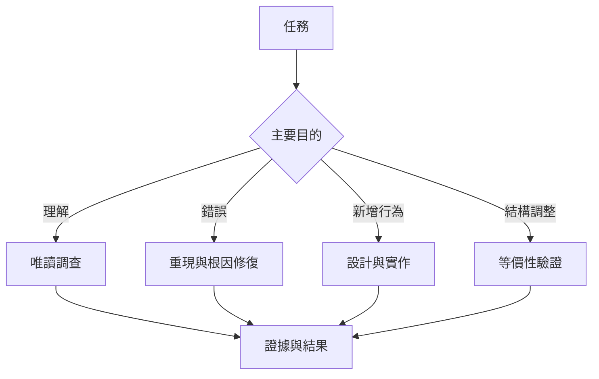

# 使用 poteto-mode

描述要達成的結果與完成條件，讓主代理選擇適當工作流。

```text
$poteto-mode 重試後會送出兩次通知。先重現，再修復，並確認同一個事件只通知一次。
```



有用的提示包含目標、可通過或失敗的完成條件、現有證據，以及真實限制。不要用「改善品質」代替驗收條件。

```text
$poteto-mode 新增 --json 參數。原本文字輸出必須完全相同，兩種格式都要驗證。這次只交付本地修改。
```

需要計畫或唯讀結果時直接說明。Plan mode 不會因為 skill 提到實作步驟就失效。

多個獨立任務可分開聊天；同一任務內由主代理管理 subagents。不要把 Cursor 的 Custom Mode 或快捷鍵視為 Codex 的必要操作。

完整 22 個工作流見 [playbooks](../../skills/poteto-mode/playbooks/)。大型跨領域工作由 [figure-it-out](../../skills/figure-it-out/SKILL.md) 設計分段驗證流程。

下一章：[理解現有程式](03-understand.md)。
