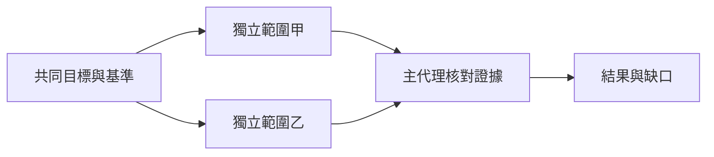

# 設計與多代理分工

先選擇分工的目的，再決定代理數量。

| 目的 | 工具 | 交付 |
| --- | --- | --- |
| 定義邊界、型別與擁有者 | architect | 可供實作的形狀與取捨 |
| 比較同一題的獨立方案 | arena | 選定基底並整合值得保留的部分 |
| 覆蓋不同套件或測試範圍 | swarm | 每個必要範圍的結果與缺口 |
| 找出變更的失敗案例 | interrogate | 可重現、經核對的 findings |

```text
$swarm 分別檢查 parser、storage、CLI。每個 worker 使用自己的輸出位置，回報基準版本、檢查指令與結果。
```

主代理負責共同目標與整合；每份工作有明確範圍、基準與驗收方式。寫入工作使用獨立 worktree；工作數超過容量時分批，不讓代理爭用同一份 checkout。



同模型的兩個代理代表獨立嘗試，並不等於跨廠商評審。沒有多代理工具時可以循序探索，但必須揭露失去的獨立性；需要獨立驗證才能交付時，這仍是未完成的條件。

能用小實驗確認的技術問題，使用 Prototype；產品方向與不可逆取捨則由使用者決定。只要求計畫時，交付計畫，不開始實作。

下一章：[實作與整理](05-build-and-clean.md)。
